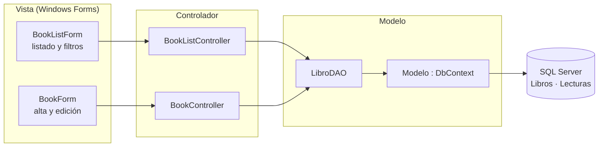
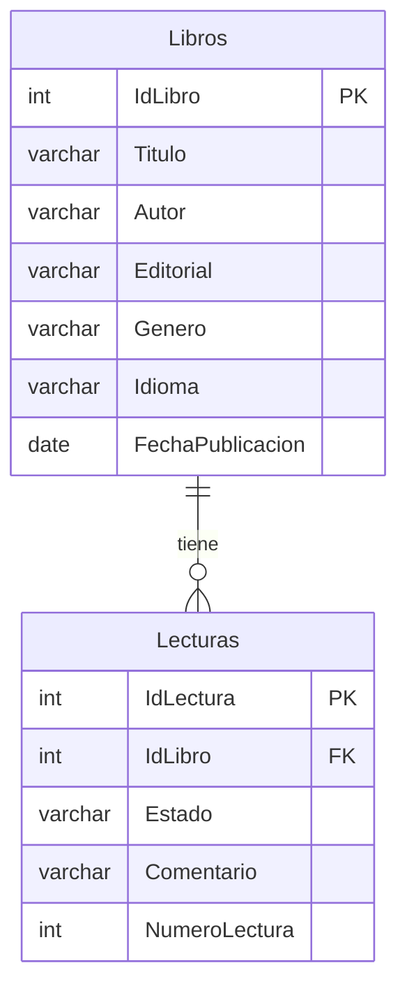

# 📚 Gestión de Biblioteca Personal

Aplicación de escritorio para Windows que sirve para gestionar una biblioteca personal: un catálogo de libros con búsqueda y filtros, y el seguimiento de cada lectura (estado, número de relecturas y comentario personal).

**C# · Windows Forms · .NET Framework 4.7.2 · Entity Framework 6 (Code-First) · LINQ · SQL Server**

> Proyecto final del Ciclo Formativo de Grado Superior en Desarrollo de Aplicaciones Multiplataforma (DAM). Es la **versión 1** de un caso que después rehíce como aplicación web full-stack (*bibliotrack*: React, Node, Prisma y PostgreSQL).

---

## ✨ Qué hace

- **Catálogo** en una tabla, con el comentario del libro seleccionado en un panel lateral.
- **Filtros combinables** por autor, editorial, género y estado de lectura. Se resuelven en la base de datos, en una sola consulta.
- **Alta** de un libro junto con su lectura inicial, guardados en una única transacción.
- **Modificación** de libro y lectura. Solo se actualizan los campos que han cambiado.
- **Borrado** con confirmación. Las lecturas del libro se eliminan con él.
- **Validación** de campos obligatorios y de la fecha de publicación (no puede ser futura), con mensajes en español.

---

## 🚀 Probarla

### Requisitos

| | |
|---|---|
| Sistema | Windows 10 u 11 |
| .NET Framework 4.7.2 | Ya viene instalado en Windows 10 (versión 1803 o posterior) y en Windows 11 |
| Base de datos | **SQL Server Express LocalDB** (gratuito). Se instala con Visual Studio 2022 (carga de trabajo *Desarrollo de escritorio de .NET*) o por separado desde el [instalador de SQL Server Express](https://www.microsoft.com/es-es/sql-server/sql-server-downloads) → *Descargar medios* → *LocalDB* |

### Opción A · Ejecutable (sin compilar)

1. Descarga `GestionBiblioteca-v1.0.zip` desde [**Releases**](https://github.com/dredonse/gestion-biblioteca/releases/latest) y descomprímelo.
2. Ejecuta `GestionBiblioteca.exe`. Como el ejecutable no está firmado, Windows SmartScreen puede avisar: *Más información → Ejecutar de todas formas*.
3. Al arrancar, Entity Framework crea automáticamente la base de datos `Biblioteca` en LocalDB. La aplicación empieza vacía.

### Opción B · Desde el código

1. Clona el repositorio y abre `GestionBiblioteca.sln` en **Visual Studio 2022**.
2. Pulsa **F5**. Los paquetes NuGet (Entity Framework 6.5.1) se restauran solos al compilar.
3. Igual que en la opción A, la base de datos se crea en el primer arranque.

### Cargar datos de ejemplo (opcional)

Con la aplicación arrancada al menos una vez, carga 25 libros de ejemplo, cada uno con su lectura:

```bat
sqlcmd -S "(localdb)\MSSQLLocalDB" -d Biblioteca -i sql\datos-ejemplo.sql
```

También puedes abrir `sql/datos-ejemplo.sql` en Visual Studio (*Explorador de objetos de SQL Server*) o en SQL Server Management Studio y ejecutarlo contra la base de datos `Biblioteca`. El script solo inserta datos si la tabla está vacía.

> **¿Usas SQL Server Express en lugar de LocalDB?** Cambia el `data source` de la cadena de conexión `Modelo` en `App.config` (o en `GestionBiblioteca.exe.config`, si usas el ejecutable) por `.\SQLEXPRESS`.

---

## 🏗️ Arquitectura

La aplicación sigue el patrón **MVC**: los formularios hacen de vista, los controladores coordinan y un **DAO** concentra todo el acceso a datos mediante Entity Framework.



```
GestionBiblioteca/
├── Program.cs                  Punto de entrada: arranca con el listado
├── App.config                  Cadena de conexión y proveedor de Entity Framework
├── Modelo.cs                   DbContext + entidades Libro y Lectura (anotaciones Code-First)
├── Modelos/LibroDAO.cs         Acceso a datos: consultas LINQ, alta, edición y borrado
├── Controladores/              BookListController, BookController
├── DTOs/                       LibroVistaDTO (fila del listado), LibroCompletoDTO (edición)
└── Vistas/                     BookListForm, BookForm
sql/datos-ejemplo.sql           Datos de ejemplo opcionales
```

### Modelo de datos



El esquema lo genera Entity Framework a partir de las clases (Code-First). La clave foránea se crea con borrado en cascada.

---

## 🧠 Decisiones técnicas

- **Filtros con LINQ diferido.** Cada filtro con valor añade un `Where` a la consulta. Como LINQ sobre Entity Framework no se ejecuta hasta el `ToList()`, se genera **una única consulta SQL** con todos los filtros en el `WHERE`, parametrizada y proyectada a un DTO con solo las columnas que se muestran.
- **Transacción explícita en el alta.** El libro y su lectura se guardan en dos pasos (la lectura necesita el id generado del libro), así que se agrupan con `BeginTransaction()`: o se guardan los dos, o ninguno. El borrado no la necesita, porque usa un único `SaveChanges()`, que ya es atómico.
- **Edición con `Find`.** Las entidades llegan al formulario desde un contexto ya cerrado. Al guardar se recargan con `Find`, se copian solo los campos editables y Entity Framework genera el `UPDATE` únicamente de las columnas modificadas.
- **Un `DbContext` por operación**, con `using`: contextos cortos, sin datos obsoletos en memoria.
- **Autenticación integrada de Windows.** La cadena de conexión no contiene usuario ni contraseña.

## 🔍 Limitaciones conocidas

Las identifiqué al revisar el proyecto y son el punto de partida de la versión web:

- **La validación vive en los setters de las entidades** y lanza excepciones que el formulario traduce. Lo correcto sería validar en el controlador y devolver la lista de errores.
- **Una lectura por libro.** El modelo admite varias (relación 1─N), pero la interfaz gestiona solo una. La solución es una vista maestro-detalle con el historial de lecturas.
- **Las entidades se llaman `LibroDTO` y `LecturasDTO`**, aunque son entidades de Entity Framework, no DTOs.
- **Sin tests automáticos.** Las pruebas se hicieron de forma manual, de principio a fin.
- **Sin migraciones.** Un cambio en el modelo obliga a recrear la base de datos.

---

## 📄 Licencia

[MIT](LICENSE) © 2026 David Redondo Serrano
